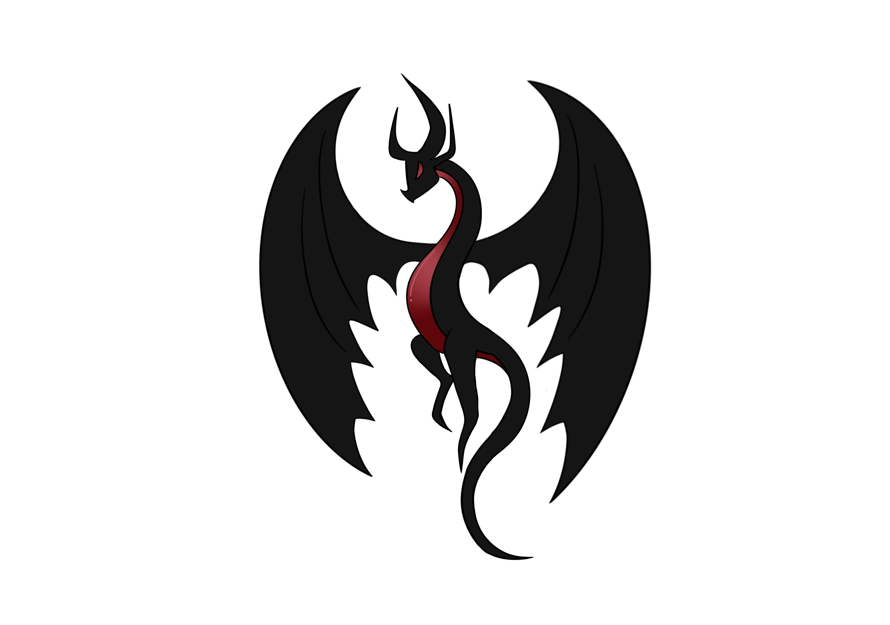

<p align="center">
  
</p>

<h1 align="center">DragoriaStudio Rank Generator</h1>

<p align="center">
  A Minecraft rank badge generator with ready-to-use packs for
  <b>Nexo</b>, <b>Oraxen</b>, <b>CraftEngine</b> and <b>ItemsAdder</b>.
</p>

<p align="center">
  <a href="README.en.md">English</a> · <a href="README.md">Polski</a>
</p>

---

## Table of contents

- [Features](#features)
- [Requirements](#requirements)
- [Quick start](#quick-start)
- [Project structure](#project-structure)
- [Target plugins](#target-plugins)
  - [Nexo](#nexo)
  - [Oraxen](#oraxen)
  - [CraftEngine](#craftengine)
  - [ItemsAdder](#itemsadder)
- [Rank packs](#rank-packs)
- [Series generator](#series-generator)
- [Paste rank list](#paste-rank-list)
- [Common rank settings](#common-rank-settings)
- [Design and typography](#design-and-typography)
- [Characters and SmallCaps](#characters-and-smallcaps)
- [Interface language](#interface-language)
- [Sharing](#sharing)
- [GitHub Pages](#github-pages)
- [Deployment checklist](#deployment-checklist)
- [Troubleshooting](#troubleshooting)

## Features

- **4 target plugins** — Nexo, Oraxen, CraftEngine, ItemsAdder
- **Multiple rank packs** — create, rename, duplicate, delete and switch
  projects; each pack has its own ranks, namespace and character range
- **Series generator** — enter `VIP-1`, choose a number step (e.g. 5) and a color gradient
- **Paste rank list** — paste server groups and create every rank automatically
- **67 color presets** plus a random palette button
- **Advanced design** - text color, 8-direction background gradient, border styles,
  rounded corners, letter spacing, bold text and a pool of 1000 pixel-art icons
- **Context preview** — chat and TAB mockups with the rank
- **Explicit `char` values** — sequential PUA characters (default from `\uE900`),
  shared across packs
- **PL / EN interface** with a saved language preference
- **Autosave** in browser storage, live preview and progress-aware ZIP export
- **Validation** — namespaces, IDs, overlapping character ranges and the
  256 px Minecraft glyph width limit

## Requirements

- [Node.js](https://nodejs.org/) 18+ (20/22 recommended)
- A modern browser (Chrome, Edge, Firefox)
- The target plugin installed on your Minecraft server

> Do not open `index.html` directly from disk (`file://`). The browser will block
> canvas access to the font atlas. Always run the local server.

## Quick start

```bash
npm install
npm run dev
```

On Windows, double-click **`start.bat`** — it installs dependencies (if needed)
and opens <http://localhost:5173>.

Production build:

```bash
npm run build
npm run preview
```

Run the built app without installing dependencies:

```bash
npm run build
start-dist.bat
```

`start-dist.bat` runs `serve.cjs` and opens <http://localhost:4173>.
The `dist/` folder can also be uploaded to any static host.

## Project structure

```text
rank/
├── src/
│   ├── App.vue                 # app state, packs, export
│   ├── components/             # editor, generator, import, pack manager
│   ├── lib/                    # renderer, packs, i18n, import, storage
│   └── style.css
├── public/
│   ├── ascii.png               # 8x8 font atlas
│   └── logo.png
├── dist/                       # production build
├── release/                    # ready-to-share ZIP
├── index.html
├── package.json
├── vite.config.js
├── start.bat                   # development mode
├── start-dist.bat              # built app
└── serve.cjs                   # tiny static server
```

## Target plugins

Choose the plugin in the **Pack → Target plugin** panel. Changing the target
automatically updates the ZIP structure, config file, install command and usage
syntax.

| Plugin | ZIP folder | Reload command | Tag / chat | PlaceholderAPI |
|---|---|---|---|---|
| Nexo | `Nexo/` | `/nexo reload` | `<glyph:rank_vip>` | `%nexo_rank_vip%` |
| Oraxen | `Oraxen/` | `/oraxen reload` | `<glyph:rank_vip>` | `%oraxen_rank_vip%` |
| CraftEngine | `CraftEngine/` | `/ce reload all` | `<image:ranks:rank_vip>` | `%image_raw_ranks:rank_vip%` |
| ItemsAdder | `ItemsAdder/` | `/iareload` + `/iazip` | `:rank_vip:` | `%img_rank_vip%` |

Every ZIP also contains:

- `README.txt` — plugin-specific instructions and the generated rank table
- `LuckPerms.txt` — ready-to-run `/lp group … meta setprefix` commands
- `TAB-groups.yml` — snippet for `plugins/TAB/config.yml`

### Nexo

**ZIP structure**

```text
Nexo/
├── glyphs/ranks.yml
└── pack/assets/ranks/textures/font/ranks/
    ├── vip.png
    ├── svip.png
    └── mvp.png
```

**Example config** (`Nexo/glyphs/ranks.yml`)

```yaml
rank_vip:
  texture: ranks:font/ranks/vip
  char: "\uE900"
  font: minecraft:default
  ascent: 8
  height: 9
  # permission: ranks.vip   # optional
```

**Installation**

1. Extract the `Nexo` folder into `plugins/`.
2. Run `/nexo reload`.
3. Verify with `/nexo glyphinfo rank_vip`.

**Usage**

- MiniMessage and compatible plugins: `<glyph:rank_vip>`
- PlaceholderAPI / TAB: `%nexo_rank_vip%`

Nexo merges files from `Nexo/pack/assets` into its generated resource pack and
sends it to players. After changing the pack, run `/nexo reload pack`.

### Oraxen

**ZIP structure**

```text
Oraxen/
├── glyphs/ranks.yml
└── pack/textures/font/ranks/
    ├── vip.png
    ├── svip.png
    └── mvp.png
```

**Example config** (`Oraxen/glyphs/ranks.yml`)

```yaml
rank_vip:
  texture: font/ranks/vip
  char: "\uE900"
  ascent: 8
  height: 9
  appearance:
    font: minecraft:default
  # chat:
  #   permission: ranks.vip
```

The `texture` path is relative to `Oraxen/pack/textures/`.

**Installation**

1. Extract the `Oraxen` folder into `plugins/`.
2. Run `/oraxen reload`.
3. Verify with `/oraxen glyphinfo rank_vip` or `/oraxen info glyph`.

**Usage**

- MiniMessage: `<glyph:rank_vip>`
- PlaceholderAPI / TAB: `%oraxen_rank_vip%`

Oraxen generates and dispatches its own resource pack. Make sure pack delivery is
enabled in the plugin configuration.

### CraftEngine

**ZIP structure**

```text
CraftEngine/
└── resources/DragoriaRanks_ranks/
    ├── pack.yml
    ├── configuration/images.yml
    └── resourcepack/assets/ranks/textures/font/ranks/
        ├── vip.png
        ├── svip.png
        └── mvp.png
```

**Example config** (`configuration/images.yml`)

```yaml
images:
  ranks:rank_vip:
    height: 9
    ascent: 8
    font: minecraft:default
    file: ranks:font/ranks/vip
    char: "\uE900"
```

**Example `pack.yml`**

```yaml
author: TroXsky
version: 1.0.0
description: DragoriaStudio rank glyphs
namespace: ranks
```

**Installation**

1. Extract the `CraftEngine` folder into `plugins/`.
2. Run `/ce reload all`.
3. Verify with `/ce debug image ranks:rank_vip`.

**Usage**

- MiniMessage / tag: `<image:ranks:rank_vip>`
- PlaceholderAPI: `%image_raw_ranks:rank_vip%`
- MiniMessage variant via PAPI: `%image_mm_ranks:rank_vip%`

The namespace in `pack.yml`, the image ID (`ranks:rank_vip`) and the texture
path (`ranks:font/ranks/vip`) must use the same namespace.

### ItemsAdder

**ZIP structure**

```text
ItemsAdder/
└── contents/ranks/
    ├── configs/ranks.yml
    └── textures/font/ranks/
        ├── vip.png
        ├── svip.png
        └── mvp.png
```

**Example config** (`configs/ranks.yml`)

```yaml
info:
  namespace: ranks
font_images:
  rank_vip:
    # permission: ranks.vip
    show_in_gui: true
    suggest_in_command: false
    path: "font/ranks/vip.png"
    symbol: "\uE900"
    scale_ratio: 9
    y_position: 8
```

**Installation**

1. Extract the `ItemsAdder` folder into `plugins/`.
2. Run `/iareload`.
3. Generate and send the pack: `/iazip`.

**Usage**

- Chat and configs: `:rank_vip:`
- PlaceholderAPI / TAB: `%img_rank_vip%`

`symbol` is an explicit PUA character. `scale_ratio` and `y_position` are tuned
for 9 px tall images so the badge stays sharp.

## Common rank settings

Every rank uses the same editor fields regardless of the target plugin:

| Field | Meaning |
|---|---|
| **Rank text** | Visible text, e.g. `VIP`, `SVIP`, `ADMIN` |
| **ID / file name** | Used in the PNG file name and glyph ID; `a-z`, `0-9`, `_`, `-` only |
| **Color preset** | Ready-made background, border and shadow theme |
| **Background / Border / Shadow** | Manual colors or a random palette |
| **Border / Shadow toggles** | Enable or disable individual elements |
| **Permission** | Optional permission written to the config |
| **Start char** | First Unicode character assigned to ranks in the pack |

Export always renders textures 1:1 in pixels (8 px of text + 1 px at the bottom)
and writes `char` explicitly, so ranks do not depend on a plugin's automatic
character assignment.

## Design and typography

The **Advanced appearance** panel in the rank editor controls every visual detail:

| Option | Effect |
|---|---|
| **Text color** | Color of letters and icons (independent of the shadow) |
| **Background** | solid or a gradient with a second color |
| **Gradient direction** | left → right, right → left, top → bottom, bottom → top and 4 diagonals |
| **Background color 2** | second gradient color |
| **Border style** | solid, double, 3D (bevel) |
| **Border width** | 1 px or 2 px |
| **Rounded corners** | transparent corner pixels |
| **Letter spacing** | 0–4 px between characters |
| **Bold** | thicker letters (one extra pixel) |
| **Icon** | a pool of 1000 pixel-art icons from 50 families, with search and family filter |
| **Icon position** | left or right of the text; the icon sits outside the plate |
| **Icon distance from rank** | 0–16 px of transparent space between the icon and the plate (1 px by default) |

Additional details:

- Polish diacritics (ą, ć, ę, ł, ń, ó, ś, ź, ż) are automatically transliterated
  to ASCII, so ranks never contain empty squares,
- the **CHAT** and **TAB** previews show the rank in a game context,
- every setting is rendered into the PNG texture and included in the 256 px
  width validation.

## Rank packs

The bar above the editor manages projects:

- **Pack selector** — switch between saved packs,
- **Manage** — rename, duplicate or delete packs,
- **+ New pack** — create a project with default ranks,
- **Save** — force an immediate save.

Data is stored in browser `localStorage`. Switching packs saves the current one
first, so you can always return later. Clearing site data removes the projects —
download the ZIP first if you need a backup.

A new pack receives a unique namespace (`ranks`, `ranks2`, …) and a character
range starting after the last used character. If ranges overlap, the app shows a
warning and a **Distribute characters automatically** button.

## Series generator

Open **⚡ Rank series generator**:

| Field | Meaning |
|---|---|
| Example rank | e.g. `VIP-1` — the last number is replaced |
| Number of ranks | batch size (up to 10,000) |
| Up to number (auto) | calculate the count from an end number |
| Number step | e.g. `5` → `1, 6, 11, 16…` |
| Change color every | `1` = smooth gradient, `5` = new color every 5 ranks |
| Color from / to | gradient endpoints (HSL interpolation) |
| Replace current list | replace instead of append |

Generated ranks receive unique IDs, colors, backgrounds and shadows derived from
the border accent, plus the next available `char` values.

## Paste rank list

Click **Paste list** above the rank list. Supported input:

```text
VIP
SVIP
MVP
ADMIN
MOD
```

Also supported:

- comma, semicolon or tab separated values,
- LuckPerms commands: `/lp creategroup vip`,
- YAML keys: `vip:`,
- list markers: `- MOD`, `1. HELPER`,
- color codes `&aVIP`, `§aVIP` and tags such as `<red>VIP</red>`,
- JSON arrays: `["VIP","SVIP"]`.

The importer removes empty entries and duplicates, skips ranks that already
exist when appending, creates unique IDs and assigns colors using one of three
styles: gradient, presets in order, or the selected rank style.

## Characters and SmallCaps

Each rank receives an explicit `char`, by default starting at `\uE900`:

```yaml
rank_vip:
  texture: ranks:font/ranks/vip
  char: "\uE900"
```

Characters are allocated sequentially and continue across packs, so two packs
never share the same character. Explicit PUA characters also prevent plugins
such as SmallCaps from replacing rank glyphs with other text glyphs.

Use the **Start char** field to set the first codepoint. Codepoints above the BMP
are written as `\U00010000`. Changing rank order changes the assignment — export
the pack again afterwards.

## Interface language

The **PL / EN** switch in the header changes the entire interface. The choice is
saved locally. Generated pack configs and helper files are in English so they can
be shared with international servers.

## Sharing

Everything needed to share the project is included:

- `README.md` (Polish) and `README.en.md` (English)
- `logo.png`
- `start.bat` — development version
- `start-dist.bat` + `serve.cjs` — built app without dependencies
- `dist/` after `npm run build` — ready for any static host
- `.github/workflows/deploy.yml` — optional GitHub Pages deployment

Recommended publishing: upload the contents of `dist/` to GitHub Pages, Netlify,
Cloudflare Pages or Vercel.

## GitHub Pages

A **stateless build** is prepared for GitHub Pages: no saved packs, no
`localStorage` and no pack manager. Refreshing the page restores the default
ranks — ideal for a public generator site.

### Automatic with GitHub Actions

1. Push the repository to GitHub.
2. Open **Settings → Pages**.
3. Set **Source: GitHub Actions**.
4. Every push to `main` runs the workflow, executes `npm run build:github`
   and publishes the `docs/` directory.

### Manual with the ready-made package

1. Use `release/DragoriaStudio-GitHub-Pages.zip`.
2. Create a GitHub repository.
3. Upload the **contents** of the ZIP into the repository root.
4. Open **Settings → Pages**.
5. Choose **Deploy from a branch → main → / (root)**.

### Local preview of the GitHub build

```bash
npm run build:github
```

Then on Windows run **`start-github.bat`** — the server starts at
<http://localhost:4174>. Manually:

```bash
set SERVE_DIR=docs
set PORT=4174
node serve.cjs
```

The GitHub build does not save packs or settings in the browser. The interface
language also resets after a refresh — this is intentional for the public site.

## Deployment checklist

1. Choose the target plugin and set the namespace, prefix and start char.
2. Add or import all ranks and check the live preview.
3. Export the pack and extract the matching folder into `plugins/`.
4. Run the reload command for the selected plugin.
5. Test one rank in game (`/… glyphinfo`, `/ce debug image`, chat test).
6. Add LuckPerms prefixes and the TAB snippet from the ZIP.
7. Test the rank on a player account without admin permissions.
8. Keep the ZIP or the pack project as a backup.

## Troubleshooting

**Ranks do not appear in game**

- make sure the pack was delivered to players,
- use the correct reload command for your plugin,
- check that the namespace and glyph ID do not conflict with existing content.

**A white square appears instead of a rank**

- verify the image height is 9 px and `height`/`ascent` are correct,
- for ItemsAdder, make sure `scale_ratio: 9` and `y_position: 8` are set,
- export the pack again after changing settings.

**A rank is clipped or too wide**

- Minecraft limits a single glyph to 256 px width,
- shorten the text or split the rank into multiple glyphs.

**The preview is empty in the browser**

- do not open `index.html` through `file://`,
- run `npm run dev`, `start.bat` or `start-dist.bat`.

**Packs disappeared**

- data lives in `localStorage` of the current browser,
- clearing site data removes the projects,
- download the generated ZIP beforehand if you need a backup.

---

Created by **TroXsky** · DragoriaStudio
