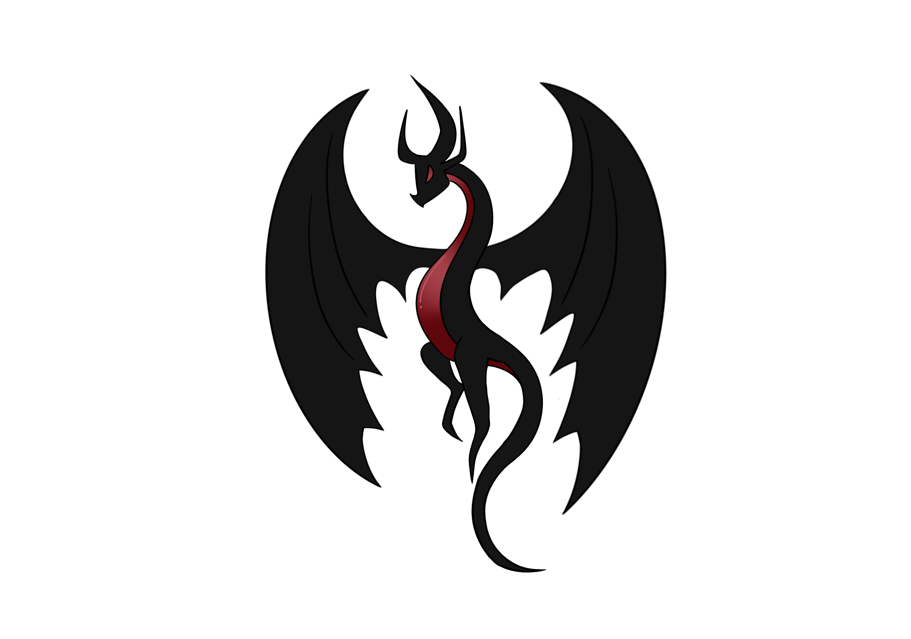

<p align="center">
  
</p>

<h1 align="center">DragoriaStudio Rank Generator</h1>

<p align="center">
  Generator pixelowych rang Minecraft z eksportem paczek dla
  <b>Nexo</b>, <b>Oraxen</b>, <b>CraftEngine</b> i <b>ItemsAdder</b>.
</p>

<p align="center">
  <a href="README.md">Polski</a> · <a href="README.en.md">English</a>
</p>

---

## Spis treści

- [Funkcje](#funkcje)
- [Wymagania](#wymagania)
- [Szybki start](#szybki-start)
- [Struktura projektu](#struktura-projektu)
- [Pluginy docelowe](#pluginy-docelowe)
  - [Nexo](#nexo)
  - [Oraxen](#oraxen)
  - [CraftEngine](#craftengine)
  - [ItemsAdder](#itemsadder)
- [Paczki rang](#paczki-rang)
- [Generator serii](#generator-serii)
- [Import listy rang](#import-listy-rang)
- [Wspólne parametry rang](#wspólne-parametry-rang)
- [Wygląd i typografia](#wygląd-i-typografia)
- [Znaki i SmallCaps](#znaki-i-smallcaps)
- [Język interfejsu](#język-interfejsu)
- [Udostępnianie](#udostępnianie)
- [GitHub Pages](#github-pages)
- [Checklista wdrożenia](#checklista-wdrożenia)
- [Rozwiązywanie problemów](#rozwiązywanie-problemów)

## Funkcje

- **4 pluginy docelowe** — Nexo, Oraxen, CraftEngine, ItemsAdder
- **Wiele paczek rang** — tworzenie, zmiana nazwy, duplikowanie, usuwanie
  i przełączanie projektów; każda paczka ma własne rangi, namespace i zakres znaków
- **Generator serii** — wpisujesz `VIP-1`, wybierasz krok (np. 5) i gradient kolorów
- **Import listy rang** — wklejasz listę z serwera, narzędzie tworzy wszystkie rangi
- **67 presetów kolorów** + przycisk losowania palety
- **Rozbudowany design** — kolor tekstu, gradient tła w 8 kierunkach, style bordera,
  zaokrąglenia, odstępy, pogrubienie i pula 1000 ikon pixel-art
- **Podgląd w kontekście** — symulacja chatu i TAB z rangą
- **Jawne znaki `char`** — kolejne znaki PUA (domyślnie od `\uE900`), wspólne dla paczek
- **Interfejs PL / EN** z zapamiętywaniem wyboru
- **Autozapis** projektów w przeglądarce, podgląd na żywo, eksport ZIP z postępem
- **Walidacja** — namespace, ID, nakładające się zakresy znaków, limit 256 px

## Wymagania

- [Node.js](https://nodejs.org/) 18+ (zalecane 20/22)
- Nowoczesna przeglądarka (Chrome, Edge, Firefox)
- Docelowy plugin zainstalowany na serwerze Minecraft

> Nie otwieraj `index.html` bezpośrednio z dysku (`file://`) — przeglądarka
> zablokuje odczyt atlasu fontu. Uruchamiaj przez lokalny serwer.

## Szybki start

```bash
npm install
npm run dev
```

Windows: dwuklik na **`start.bat`** — instaluje zależności (jeśli trzeba)
i otwiera <http://localhost:5173>.

Build produkcyjny:

```bash
npm run build
npm run preview
```

Gotowy build można uruchomić bez instalowania zależności:

```bash
npm run build
start-dist.bat
```

`start-dist.bat` uruchamia `serve.cjs` i otwiera <http://localhost:4173>.
Katalog `dist/` można też wgrać na dowolny hosting statyczny.

## Struktura projektu

```text
rank/
├── src/
│   ├── App.vue                 # stan aplikacji, paczki, eksport
│   ├── components/             # edytor, generator, import, modal paczek
│   ├── lib/                    # renderer, paczki, i18n, import, storage
│   └── style.css
├── public/
│   ├── ascii.png               # atlas fontu 8x8 px
│   └── logo.png
├── dist/                       # build produkcyjny
├── release/                    # gotowy ZIP do udostępniania
├── index.html
├── package.json
├── vite.config.js
├── start.bat                   # tryb developerski
├── start-dist.bat              # gotowy build
└── serve.cjs                   # prosty serwer statyczny
```

## Pluginy docelowe

Wybór znajduje się w panelu **Paczka → Plugin docelowy**. Zmiana pluginu
automatycznie zmienia strukturę ZIP-a, plik konfiguracji, komendy instalacji
oraz sposób użycia w grze.

| Plugin | Katalog w ZIP | Komenda przeładowania | Tag / chat | PlaceholderAPI |
|---|---|---|---|---|
| Nexo | `Nexo/` | `/nexo reload` | `<glyph:rank_vip>` | `%nexo_rank_vip%` |
| Oraxen | `Oraxen/` | `/oraxen reload` | `<glyph:rank_vip>` | `%oraxen_rank_vip%` |
| CraftEngine | `CraftEngine/` | `/ce reload all` | `<image:ranks:rank_vip>` | `%image_raw_ranks:rank_vip%` |
| ItemsAdder | `ItemsAdder/` | `/iareload` + `/iazip` | `:rank_vip:` | `%img_rank_vip%` |

Każda paczka zawiera dodatkowo:

- `README.txt` — instrukcja dla wybranego pluginu i tabela rang
- `LuckPerms.txt` — gotowe komendy `/lp group … meta setprefix`
- `TAB-groups.yml` — fragment do `plugins/TAB/config.yml`

### Nexo

**Struktura ZIP-a**

```text
Nexo/
├── glyphs/ranks.yml
└── pack/assets/ranks/textures/font/ranks/
    ├── vip.png
    ├── svip.png
    └── mvp.png
```

**Przykładowa konfiguracja** (`Nexo/glyphs/ranks.yml`)

```yaml
rank_vip:
  texture: ranks:font/ranks/vip
  char: "\uE900"
  font: minecraft:default
  ascent: 8
  height: 9
  # permission: ranks.vip   # opcjonalnie
```

**Instalacja**

1. Wypakuj folder `Nexo` do `plugins/`.
2. Uruchom `/nexo reload`.
3. Sprawdź `/nexo glyphinfo rank_vip`.

**Użycie**

- MiniMessage / inne pluginy: `<glyph:rank_vip>`
- PlaceholderAPI / TAB: `%nexo_rank_vip%`

Nexo samo dokleja pliki z `Nexo/pack/assets` do generowanego resource packa
i rozsyła go graczom. Po zmianie paczki użyj `/nexo reload pack`.

### Oraxen

**Struktura ZIP-a**

```text
Oraxen/
├── glyphs/ranks.yml
└── pack/textures/font/ranks/
    ├── vip.png
    ├── svip.png
    └── mvp.png
```

**Przykładowa konfiguracja** (`Oraxen/glyphs/ranks.yml`)

```yaml
rank_vip:
  texture: font/ranks/vip
  char: "\uE900"
  ascent: 8
  height: 9
  appearance:
    font: minecraft:default
  # chat:
  #   permission: ranks.vip
```

Ścieżka `texture` jest względna do `Oraxen/pack/textures/`.

**Instalacja**

1. Wypakuj folder `Oraxen` do `plugins/`.
2. Uruchom `/oraxen reload`.
3. Sprawdź `/oraxen glyphinfo rank_vip` lub `/oraxen info glyph`.

**Użycie**

- MiniMessage: `<glyph:rank_vip>`
- PlaceholderAPI / TAB: `%oraxen_rank_vip%`

Oraxen sam generuje i wysyła resource pack. Upewnij się, że wysyłanie paczki
jest włączone w konfiguracji pluginu.

### CraftEngine

**Struktura ZIP-a**

```text
CraftEngine/
└── resources/DragoriaRanks_ranks/
    ├── pack.yml
    ├── configuration/images.yml
    └── resourcepack/assets/ranks/textures/font/ranks/
        ├── vip.png
        ├── svip.png
        └── mvp.png
```

**Przykładowa konfiguracja** (`configuration/images.yml`)

```yaml
images:
  ranks:rank_vip:
    height: 9
    ascent: 8
    font: minecraft:default
    file: ranks:font/ranks/vip
    char: "\uE900"
```

**Przykładowy `pack.yml`**

```yaml
author: TroXsky
version: 1.0.0
description: DragoriaStudio rank glyphs
namespace: ranks
```

**Instalacja**

1. Wypakuj folder `CraftEngine` do `plugins/`.
2. Uruchom `/ce reload all`.
3. Sprawdź `/ce debug image ranks:rank_vip`.

**Użycie**

- MiniMessage / tag: `<image:ranks:rank_vip>`
- PlaceholderAPI: `%image_raw_ranks:rank_vip%`
- Wariant MiniMessage przez PAPI: `%image_mm_ranks:rank_vip%`

Namespace w `pack.yml`, identyfikator obrazu (`ranks:rank_vip`) i ścieżka
tekstury (`ranks:font/ranks/vip`) muszą używać tej samej nazwy.

### ItemsAdder

**Struktura ZIP-a**

```text
ItemsAdder/
└── contents/ranks/
    ├── configs/ranks.yml
    └── textures/font/ranks/
        ├── vip.png
        ├── svip.png
        └── mvp.png
```

**Przykładowa konfiguracja** (`configs/ranks.yml`)

```yaml
info:
  namespace: ranks
font_images:
  rank_vip:
    # permission: ranks.vip
    show_in_gui: true
    suggest_in_command: false
    path: "font/ranks/vip.png"
    symbol: "\uE900"
    scale_ratio: 9
    y_position: 8
```

**Instalacja**

1. Wypakuj folder `ItemsAdder` do `plugins/`.
2. Uruchom `/iareload`.
3. Wygeneruj i wyślij paczkę: `/iazip`.

**Użycie**

- Chat / konfiguracje: `:rank_vip:`
- PlaceholderAPI / TAB: `%img_rank_vip%`

`symbol` jest jawnym znakiem PUA. `scale_ratio` i `y_position` są dopasowane
do obrazków o wysokości 9 px, dzięki czemu ranga pozostaje ostra.

## Wspólne parametry rang

Każda ranga w edytorze ma te same pola, niezależnie od pluginu docelowego:

| Pole | Znaczenie |
|---|---|
| **Tekst rangi** | Widoczny napis, np. `VIP`, `SVIP`, `ADMIN` |
| **ID / nazwa pliku** | Trafia do nazwy PNG i ID glyphu; tylko `a-z`, `0-9`, `_`, `-` |
| **Preset kolorów** | Gotowy motyw tła, bordera i cienia |
| **Tło / Border / Cień** | Ręczne kolory lub losowa paleta |
| **Obramowanie / Cień** | Włączanie i wyłączanie elementów |
| **Permission** | Opcjonalne uprawnienie zapisywane w konfiguracji |
| **Start char** | Pierwszy znak Unicode przypisany do rang w paczce |

Eksport zawsze renderuje teksturę 1:1 w pikselach (8 px tekstu + 1 px dołu)
i zapisuje `char` jawnie, dzięki czemu rangi nie zależą od automatycznego
przydziału znaków przez plugin.

## Wygląd i typografia

Panel **Wygląd zaawansowany** w edytorze rangi pozwala dopracować każdy element:

| Opcja | Działanie |
|---|---|
| **Kolor tekstu** | Kolor liter i ikon (niezależny od cienia) |
| **Tło** | jednolite lub gradient z drugim kolorem |
| **Kierunek gradientu** | lewo → prawo, prawo → lewo, góra → dół, dół → góra oraz 4 ukosy |
| **Kolor tła 2** | drugi kolor gradientu |
| **Styl bordera** | zwykły, podwójny, 3D (bevel) |
| **Grubość bordera** | 1 px lub 2 px |
| **Zaokrąglone rogi** | przezroczyste piksele w narożnikach |
| **Odstęp liter** | 0–4 px między znakami |
| **Pogrubienie** | grubsze litery (dodatkowy piksel) |
| **Ikona** | pula 1000 ikon pixel-art z 50 rodzin, z wyszukiwarką i filtrem |
| **Pozycja ikony** | z lewej lub z prawej strony tekstu; ikona leży poza tłem |
| **Odstęp ikony od rangi** | 0–16 px przezroczystego odstępu między ikoną a płytką (domyślnie 1 px) |

Dodatkowo:

- polskie znaki (ą, ć, ę, ł, ń, ó, ś, ź, ż) są automatycznie zamieniane na
  odpowiedniki ASCII, więc rangi nie zawierają pustych kwadratów,
- podgląd **CHAT** i **TAB** pokazuje rangę w kontekście gry,
- wszystkie ustawienia trafiają do renderowanej tekstury PNG i są uwzględniane
  przy sprawdzaniu limitu 256 px.

## Paczki rang

Pasek nad edytorem pozwala zarządzać projektami:

- **lista rozwijana** — przełączanie zapisanych paczek,
- **Zarządzaj** — zmiana nazwy, duplikowanie, usuwanie,
- **+ Nowa paczka** — nowy projekt z domyślnymi rangami,
- **Zapisz** — natychmiastowy zapis.

Dane trzymane są w `localStorage` przeglądarki. Przełączenie paczki najpierw
zapisuje bieżącą, więc możesz do niej wrócić później. Wyczyszczenie danych strony
usunie projekty — pobierz ZIP, jeśli chcesz mieć kopię.

Nowa paczka dostaje unikalny namespace (`ranks`, `ranks2`, …) oraz zakres
znaków zaczynający się po ostatnim użytym znaku. Przy nakładaniu się zakresów
pojawi się ostrzeżenie z przyciskiem **Rozdziel znaki automatycznie**.

## Generator serii

Otwórz **⚡ Generator serii rang**:

| Pole | Znaczenie |
|---|---|
| Przykład rangi | np. `VIP-1` — ostatnia liczba jest podmieniana |
| Liczba rang | rozmiar partii (do 10 000) |
| Do numeru (auto) | wylicza liczbę rang na podstawie numeru końcowego |
| Krok liczby | np. `5` → `1, 6, 11, 16…` |
| Zmiana koloru co | `1` = płynny gradient, `5` = zmiana co 5 rang |
| Kolor od / do | końce gradientu (interpolacja HSL) |
| Zastąp obecną listę | zastępuje zamiast dopisywać |

Wygenerowane rangi dostają unikalne ID, kolory, tło i cień wyliczone z koloru
bordera oraz kolejne znaki `char`.

## Import listy rang

Kliknij **Wklej listę** nad listą rang. Obsługiwane formaty:

```text
VIP
SVIP
MVP
ADMIN
MOD
```

Dodatkowo:

- wartości rozdzielone przecinkiem, średnikiem lub tabulatorem,
- komendy LuckPerms: `/lp creategroup vip`,
- klucze YAML: `vip:`,
- listy z myślnikami/numeracją: `- MOD`, `1. HELPER`,
- kody kolorów `&aVIP`, `§aVIP` i tagi `<red>VIP</red>`,
- tablice JSON: `["VIP","SVIP"]`.

Importer usuwa puste pozycje i duplikaty, pomija rangi już istniejące
(przy dopisywaniu), nadaje unikalne ID i kolory w jednym z trybów: gradient,
presety po kolei albo styl zaznaczonej rangi.

## Znaki i SmallCaps

Każda ranga dostaje jawny `char`, domyślnie od `\uE900`:

```yaml
rank_vip:
  texture: ranks:font/ranks/vip
  char: "\uE900"
```

Znaki są przydzielane po kolei i kontynuowane między paczkami, więc dwie paczki
nie używają tego samego znaku. Jawne znaki PUA zapobiegają podmienianiu rang
przez pluginy typu SmallCaps.

Pole **Start char** pozwala ustawić pierwszy kod. Znaki spoza BMP są zapisywane
jako `\U00010000`. Zmiana kolejności rang zmienia przypisania — wygeneruj paczkę
ponownie.

## Język interfejsu

Przełącznik **PL / EN** w nagłówku zmienia cały interfejs. Wybór jest zapisywany
lokalnie. Pliki konfiguracyjne i pomocnicze w paczkach są w języku angielskim,
aby można je było udostępniać międzynarodowym serwerom.

## Udostępnianie

Projekt zawiera wszystko, co potrzebne do udostępnienia:

- `README.md` (polski) i `README.en.md` (angielski)
- `logo.png`
- `start.bat` — wersja developerska
- `start-dist.bat` + `serve.cjs` — gotowy build bez zależności
- `dist/` po `npm run build` — do wgrania na hosting statyczny
- `.github/workflows/deploy.yml` — opcjonalny deploy na GitHub Pages

Zalecany sposób publikacji: wgraj zawartość `dist/` na GitHub Pages, Netlify,
Cloudflare Pages lub Vercel.

## GitHub Pages

Do publikacji jako strona GitHub przygotowany jest **bezstanowy build**:
bez zapisywania paczek, bez `localStorage` i bez panelu zarządzania paczkami.
Po odświeżeniu strony wracają domyślne rangi — idealne na publiczną stronę
z generatorem.

### Automatycznie przez GitHub Actions

1. Wgraj repozytorium na GitHub.
2. Wejdź w **Settings → Pages**.
3. Ustaw **Source: GitHub Actions**.
4. Każdy push na `main` uruchomi workflow, który wykona `npm run build:github`
   i opublikuje katalog `docs/`.

### Ręcznie z gotowej paczki

1. Weź plik `release/DragoriaStudio-GitHub-Pages.zip`.
2. Utwórz repozytorium na GitHubie.
3. Wgraj **zawartość** ZIP-a do katalogu głównego repo.
4. Wejdź w **Settings → Pages**.
5. Wybierz **Deploy from a branch → main → / (root)**.

### Lokalny podgląd wersji GitHub

```bash
npm run build:github
```

Następnie na Windows uruchom **`start-github.bat`** — serwer wystartuje pod
<http://localhost:4174>. Ręcznie:

```bash
set SERVE_DIR=docs
set PORT=4174
node serve.cjs
```

Wersja GitHub nie zapisuje paczek ani ustawień w przeglądarce. Język interfejsu
także wraca do domyślnego po odświeżeniu — to celowe zachowanie publicznej wersji.

## Checklista wdrożenia

1. Wybierz plugin docelowy i ustaw namespace, prefix oraz start char.
2. Dodaj lub zaimportuj wszystkie rangi i sprawdź podgląd.
3. Wyeksportuj paczkę i rozpakuj odpowiedni folder do `plugins/`.
4. Uruchom komendę reload dla wybranego pluginu.
5. Sprawdź jedną rangę w grze (`/… glyphinfo`, `/ce debug image`, test w chacie).
6. Dodaj prefiksy LuckPerms i snippet TAB z plików w ZIP-ie.
7. Przetestuj rangę na koncie gracza bez uprawnień administracyjnych.
8. Zachowaj ZIP lub projekt w paczce jako kopię zapasową.

## Rozwiązywanie problemów

**Rangi nie pojawiają się w grze**

- sprawdź, czy paczka została wysłana graczom,
- użyj właściwej komendy reload dla pluginu,
- upewnij się, że namespace i glyph ID nie kolidują z istniejącymi.

**Biały kwadrat zamiast rangi**

- sprawdź, czy obrazek ma wysokość 9 px i czy `height`/`ascent` są poprawne,
- w ItemsAdder upewnij się, że `scale_ratio: 9` i `y_position: 8`,
- wygeneruj paczkę ponownie po zmianie ustawień.

**Ranga jest ucięta lub za szeroka**

- limit Minecrafta to 256 px szerokości na pojedynczy glyph,
- skróć tekst lub podziel rangę na kilka glyphów.

**Podgląd w przeglądarce jest pusty**

- nie otwieraj `index.html` przez `file://`,
- uruchom `npm run dev`, `start.bat` lub `start-dist.bat`.

**Paczki zniknęły**

- dane są w `localStorage` tej przeglądarki,
- wyczyszczenie danych strony usuwa projekty,
- wcześniej pobierz ZIP z wygenerowaną paczką.

---

Stworzone przez **TroXsky** · DragoriaStudio
